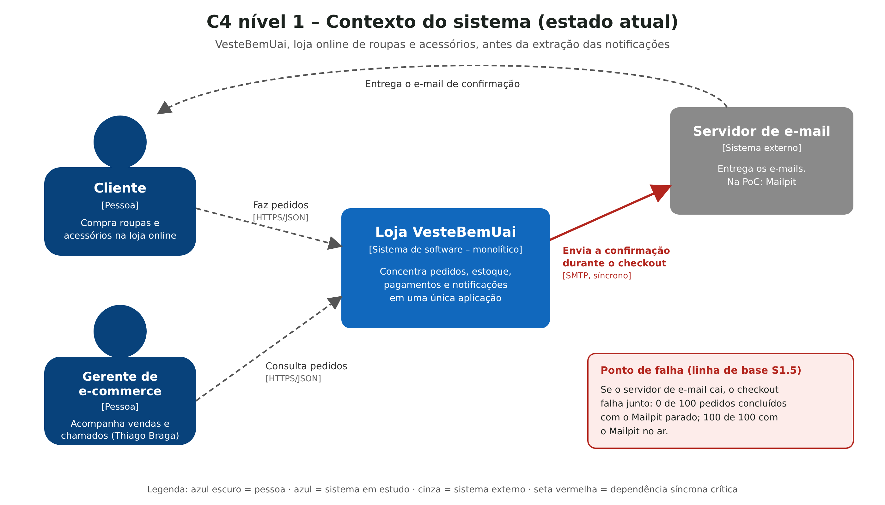
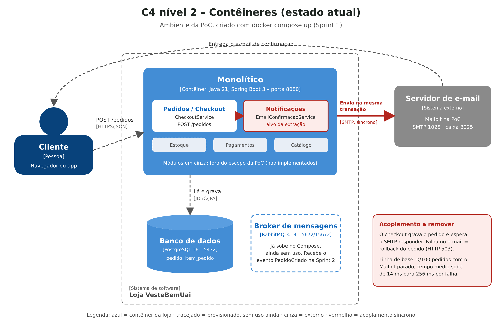
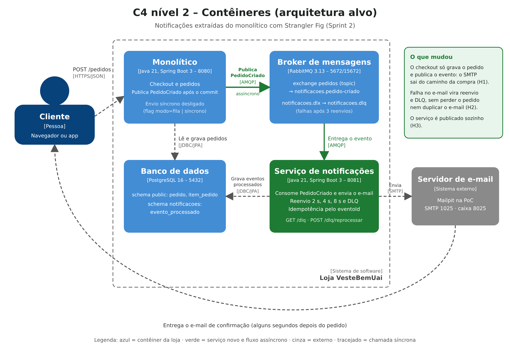
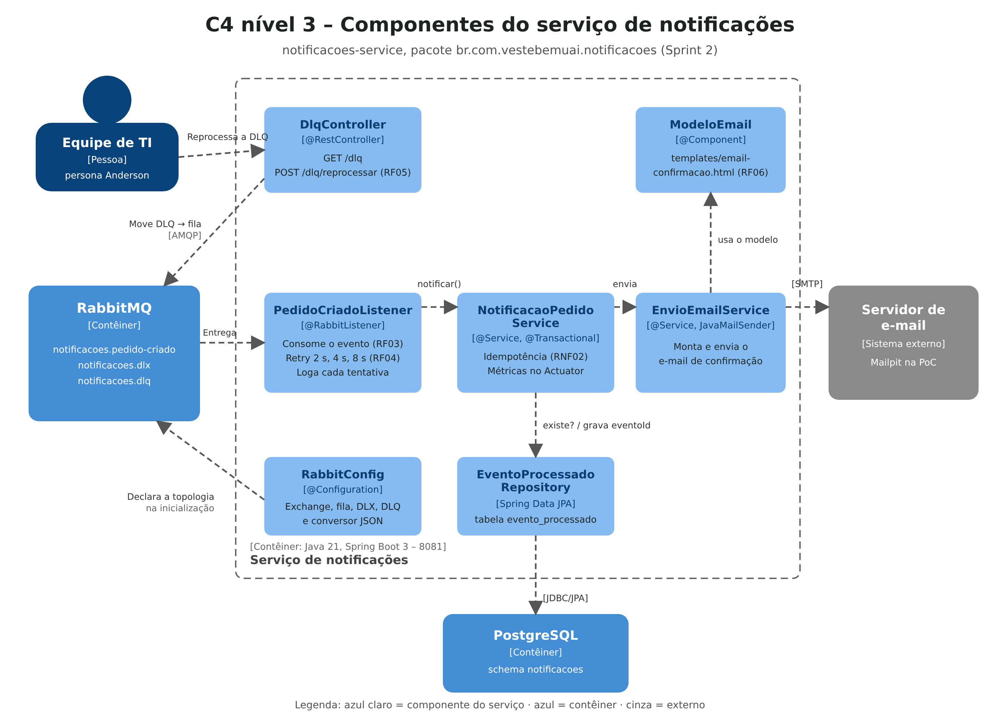
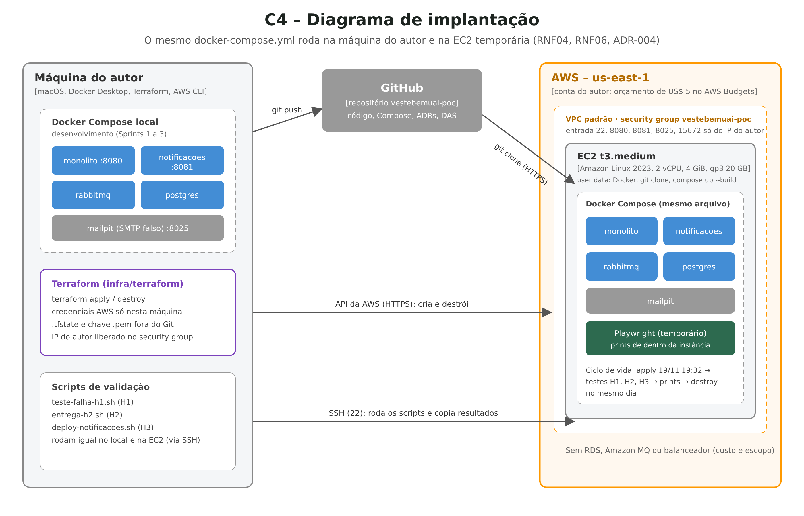

# DAS – Documento de Arquitetura de Software
## Extração do serviço de notificações da VesteBemUai

- **Versão:** 1.0 (final da Sprint 3)
- **Data:** 21/11/2026
- **Autor:** Leonardo (arquiteto e desenvolvedor do projeto)
- **Situação:** aprovado para servir de padrão às próximas extrações (hipótese H4)

A VesteBemUai é uma loja online **fictícia** de roupas e acessórios. Este documento consolida a arquitetura
da prova de conceito (PoC) construída nas Sprints 1 a 3 do Projeto Aplicado: o estado atual, a arquitetura
alvo, as decisões (ADRs), a implantação e os resultados medidos.

---

## 1. Objetivo e escopo

**Problema.** No checkout do monolítico, gravar o pedido e enviar o e-mail de confirmação acontecem na mesma
transação. Quando o servidor de e-mail cai ou fica lento, o pedido falha junto (linha de base da Sprint 1:
**0 de 100** pedidos concluídos com o e-mail parado). Mudar um texto do e-mail exige publicar o sistema inteiro.

**Objetivo (SMART).** Extrair as notificações para um microsserviço ligado por fila (RabbitMQ), com o padrão
Strangler Fig, de modo que, com 100 pedidos e o e-mail fora do ar, 100% dos pedidos sejam concluídos e, após o
retorno do e-mail, 99% ou mais das confirmações sejam entregues sem duplicados, de 02/11 a 22/11/2026.

**Dentro do escopo:** módulo de notificações (e-mail de confirmação do pedido), evento `PedidoCriado`,
reenvio, DLQ, idempotência, observabilidade, implantação local e evidência na AWS.
**Fora do escopo:** pedidos, estoque e pagamentos (melhoria futura, H5), alta disponibilidade, produção real.

## 2. Partes interessadas e preocupações

| Parte interessada | Persona | Preocupação principal | Como a arquitetura responde |
|---|---|---|---|
| Time de tecnologia | Anderson Moura (dev backend) | Deploy noturno do sistema inteiro; incidentes vindos de outro módulo | Serviço com deploy próprio; falha do e-mail isolada |
| Negócio | Thiago Braga (gerente de e-commerce) | Venda perdida e cliente sem confirmação | Checkout não depende do e-mail; reenvio e DLQ |
| Avaliação acadêmica | Orientador | Rastreabilidade problema → hipótese → evidência | Requisitos, ADRs e testes ligados às hipóteses H1 a H4 |

## 3. Requisitos e atributos de qualidade

Detalhe e critérios de aceite em [requisitos.md](requisitos.md).

| ID | Requisito | Hipótese | Atributo de qualidade |
|---|---|---|---|
| RF01 | Registrar pedido com itens pela API REST | — | Funcionalidade |
| RF02 | Publicar `PedidoCriado` sem esperar o e-mail | H1 | Desacoplamento |
| RF03 | Serviço consome o evento e envia o e-mail | H1 | Funcionalidade |
| RF04 | Reenvio 3 vezes com intervalo crescente | H2 | Confiabilidade |
| RF05 | DLQ e reprocessamento | H2 | Confiabilidade |
| RF06 | Mudar o modelo do e-mail publicando só o serviço | H3 | Implantabilidade |
| RNF01 | Checkout conclui com o e-mail fora do ar | H1 | **Disponibilidade** |
| RNF02 | No máximo um e-mail por evento | H2 | **Confiabilidade** |
| RNF03 | Logs e métricas do envio | H2 | **Observabilidade** |
| RNF04 | Ambiente sobe com um comando | H3 | Portabilidade |
| RNF05 | DAS com C4 e ADRs | H4 | Documentação |
| RNF06 | Criar e destruir o ambiente na AWS com Terraform, até US$ 5 | H3 | Implantabilidade e custo |

**Cenários de qualidade (estímulo → resposta medida):**

| Atributo | Estímulo | Resposta esperada | Medido na Sprint 3 |
|---|---|---|---|
| Disponibilidade | Servidor de e-mail parado durante 100 pedidos | 100 pedidos com HTTP 201 | 100/100 local e 100/100 na AWS |
| Confiabilidade | E-mail volta depois de as mensagens irem para a DLQ | ≥ 99% entregues, 0 duplicados | 100%, 0 duplicados (local e AWS) |
| Implantabilidade | Mudança no texto do e-mail | Publicar só o serviço, sem parar o checkout | 14,7 s local, 30,6 s na AWS; 0 pedidos perdidos |
| Observabilidade | Falha no envio | Falha visível em métrica, log e painel | `notificacoes.emails.falhas`, `notificacoes.mensagens.dlq`, painel do RabbitMQ |

## 4. Restrições e premissas

- 3 sprints de 7 dias, um desenvolvedor, cerca de 15 h por semana.
- Stack: Java 21, Spring Boot 3.5, RabbitMQ 3.13, PostgreSQL 16, Mailpit (SMTP falso), Docker Compose.
- Custo zero no desenvolvimento; evidência na AWS limitada a **US$ 5** (alerta no AWS Budgets).
- Monolítico simulado, criado pelo projeto, representando o sistema de 6 anos da loja.

## 5. Visões da arquitetura (C4 Model)

### 5.1 Contexto (nível 1) – estado atual

### 5.2 Contêineres (nível 2) – antes e depois

| Estado atual (Sprint 1) | Arquitetura alvo (Sprint 2) |
|---|---|
|  |  |

No estado atual o monolítico chama o SMTP dentro da transação do checkout. Na arquitetura alvo o checkout grava
o pedido e publica `PedidoCriado` no exchange `pedidos` **depois do commit**; o `notificacoes-service` consome a
fila `notificacoes.pedido-criado`, envia o e-mail e é dono do schema `notificacoes`.

### 5.3 Componentes do serviço de notificações (nível 3)

| Componente | Responsabilidade |
|---|---|
| `PedidoCriadoListener` | Consome a fila (10 consumidores), registra cada tentativa e conta falhas |
| `NotificacaoPedidoService` | Idempotência pelo `eventoId` e envio na mesma transação |
| `EnvioEmailService` + `ModeloEmail` | Monta o e-mail a partir de `templates/email-confirmacao.html` (RF06) |
| `RabbitConfig` | Topologia: exchange, fila principal, DLX e DLQ |
| `DlqController` | `GET /dlq` e `POST /dlq/reprocessar` |
| `MetricasFilas` | Medidores do tamanho da fila e da DLQ no Actuator |

### 5.4 Fluxo dinâmico (falha e recuperação)

1. Cliente faz `POST /pedidos`; o monolítico grava o pedido e responde **201**.
2. Após o commit, `PedidoCriado` vai para o exchange `pedidos` (rota `pedido.criado`).
3. O serviço tenta enviar: falha → nova tentativa em 2 s, 4 s e 8 s → rejeita → **DLQ**.
4. O e-mail volta; `POST /dlq/reprocessar` devolve as mensagens à fila principal.
5. O serviço envia; um `eventoId` já processado é ignorado (sem duplicado).

### 5.5 Implantação

O mesmo `docker-compose.yml` roda na máquina do autor e na EC2. O Terraform em
[`infra/terraform`](../infra/terraform) cria uma EC2 t3.medium (Amazon Linux 2023), um security group aberto
só para o IP do autor e uma chave SSH; o *user data* instala o Docker, clona o repositório e sobe o Compose.

## 6. Decisões de arquitetura (ADRs)

| ADR | Decisão | Alternativas descartadas | Hipótese |
|---|---|---|---|
| [ADR-001](adr/ADR-001-strangler-fig-notificacoes.md) | Strangler Fig, começando pelas notificações | Reescrita completa (big bang); `@Async` dentro do monolítico | H1, H3 |
| [ADR-002](adr/ADR-002-rabbitmq-como-broker.md) | RabbitMQ como broker (exchange topic + filas duráveis) | Kafka; Amazon SQS; tabela do PostgreSQL como fila | H1 |
| [ADR-003](adr/ADR-003-reenvio-e-dlq.md) | Reenvio 2/4/8 s, DLQ com reprocessamento, idempotência pelo `eventoId` | Requeue infinito; descartar; confiar no broker | H2 |
| [ADR-004](adr/ADR-004-evidencia-aws-terraform.md) | EC2 temporária com Terraform, destruída no mesmo dia | ECS + Amazon MQ + RDS; EKS; console | H3 |

## 7. Resultados da validação (Sprint 3)

Scripts em [`scripts/`](../scripts); saídas em [`docs/sprints/sprint-3/evidencias`](sprints/sprint-3/evidencias).

| Hipótese | Teste | Linha de base / antes | Resultado local | Resultado na AWS | Situação |
|---|---|---|---|---|---|
| **H1** | 100 pedidos com o Mailpit parado (`teste-falha-h1.sh`) | 0/100 concluídos, HTTP 503 | **100/100**, HTTP 201, 16 ms em média | **100/100**, HTTP 201, 30 ms em média | Validada |
| **H2** | Reenvio, DLQ e reprocessamento após o retorno (`entrega-h2.sh`) | — | 400 falhas registradas, 100 na DLQ, **100% entregues, 0 duplicados** | **100% entregues, 0 duplicados** | Validada |
| **H3** | Mudar o modelo e publicar só o serviço (`deploy-notificacoes.sh`) | Deploy do sistema inteiro em janela noturna | **14,7 s**, 38/38 pedidos com 201 durante a troca | **30,6 s** (build com Maven incluso), 66/66 com 201 | Validada |
| **H3** | Ambiente na nuvem com Terraform (RNF06) | — | — | Ambiente pronto em 126 s após o `apply`; `destroy` no mesmo dia | Validada |
| **H4** | Este DAS + C4 + ADRs reutilizáveis | — | Documento único com visões, decisões e roteiro (seção 9) | — | Validada (com ressalva: reuso só será provado na próxima extração) |

## 8. Riscos e dívidas técnicas conhecidas

| Risco | Impacto | Mitigação proposta |
|---|---|---|
| Se o **RabbitMQ** estiver fora do ar no momento do commit, o pedido é gravado mas o evento se perde (log de erro) | Pedido sem e-mail | **Transactional Outbox**: gravar o evento numa tabela na mesma transação e publicar depois |
| Reenvio em memória segura a thread durante 14 s por mensagem | Vazão menor em falha longa | 10 consumidores hoje; para volumes maiores, filas de espera com TTL |
| Banco compartilhado (schemas separados no mesmo PostgreSQL) | Acoplamento de infraestrutura | Banco próprio quando o serviço for para produção |
| Uma instância só, sem HA | Indisponibilidade da evidência | Aceito para a PoC; em produção, ECS/EKS com 2+ réplicas e Amazon MQ |
| Mailpit guarda e-mails em memória | Perde a contagem ao reiniciar | Scripts contam por prefixo depois do retorno; volume em produção não se aplica |

## 9. Roteiro de reuso para o próximo módulo (H4 e H5)

1. **Escolher o módulo** pelo critério da Sprint 1: tarefa secundária acoplada ao fluxo principal (candidatos:
   cálculo de frete, baixa de estoque, emissão de nota).
2. **Medir a linha de base** com um script no formato de `linha-de-base.sh` antes de mexer no código.
3. **Escrever o ADR** usando os ADR-001 a 004 como modelo (contexto, opções, decisão, consequências).
4. **Publicar um evento após o commit** (de preferência com Outbox) e criar o serviço com fila própria, DLQ e
   idempotência pelo `eventoId`, copiando a topologia do `RabbitConfig`.
5. **Manter uma flag** como `NOTIFICACAO_MODO` para voltar ao modo antigo e comparar antes e depois.
6. **Validar** com os três scripts (falha, entrega, deploy isolado) e atualizar este DAS e o C4.

## 10. Rastreabilidade

| Requisito | Código | Teste automatizado | Evidência |
|---|---|---|---|
| RF02 / RNF01 | `CheckoutService`, `PublicadorPedidoCriado` | `CheckoutFilaTest` | `teste-falha-h1.sh` (local e AWS) |
| RF03 | `PedidoCriadoListener`, `EnvioEmailService` | `NotificacaoPedidoTest` | Mailpit com 100 e-mails |
| RF04 / RF05 | `application.yml`, `RabbitConfig`, `DlqController` | `TopologiaRabbitTest` | DLQ com 100 no painel; `entrega-h2.sh` |
| RNF02 | `NotificacaoPedidoService`, `EventoProcessado` | `NotificacaoPedidoTest`, `MetricasTest` | 0 duplicados |
| RNF03 | `MetricasFilas`, contadores Micrometer | `MetricasTest` | `/actuator/metrics` |
| RF06 | `ModeloEmail`, `email-confirmacao.html` | — | `deploy-notificacoes.sh` |
| RNF04 / RNF06 | `docker-compose.yml`, `infra/terraform` | — | `terraform apply/destroy`, `pronto.txt` |
